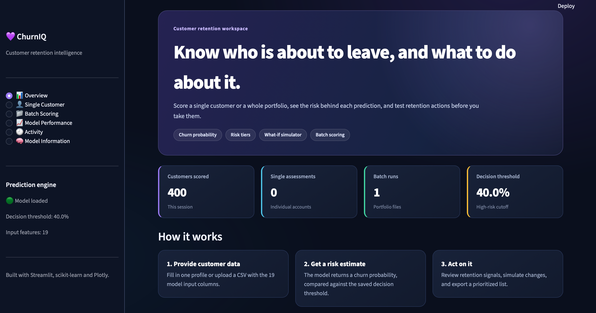
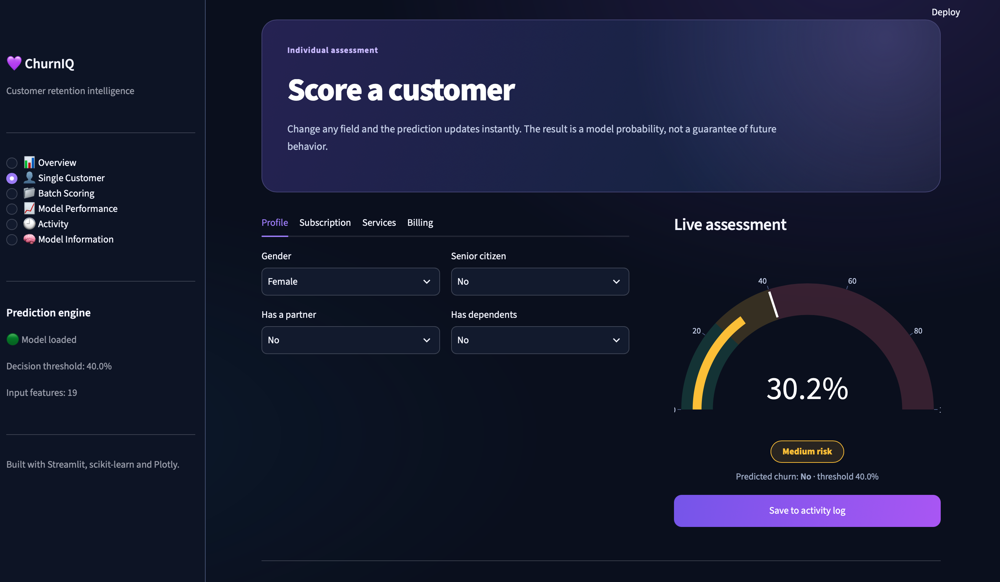
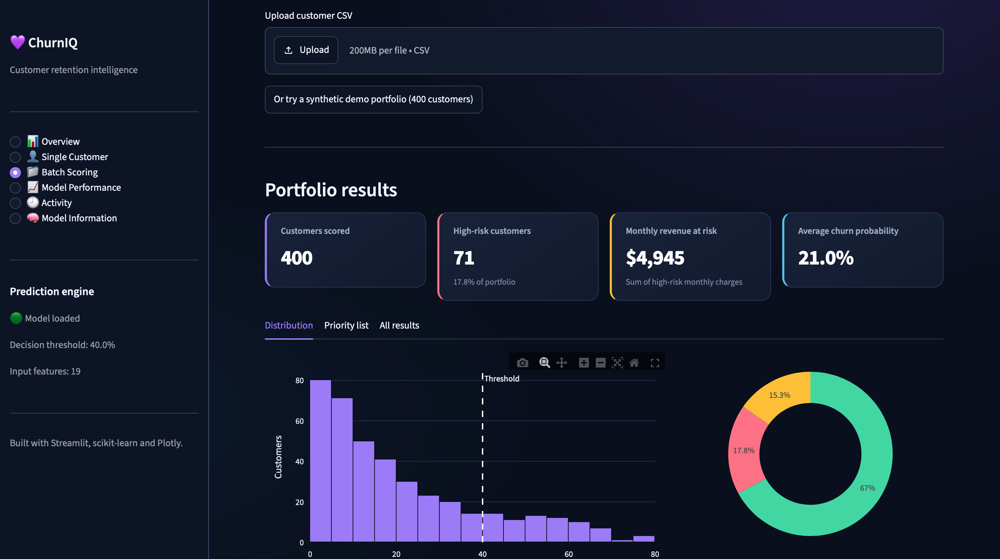
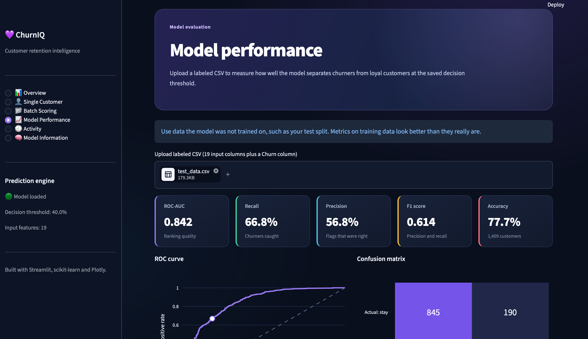
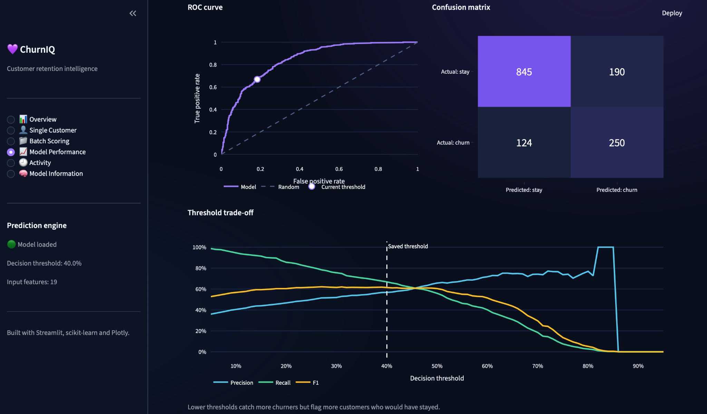
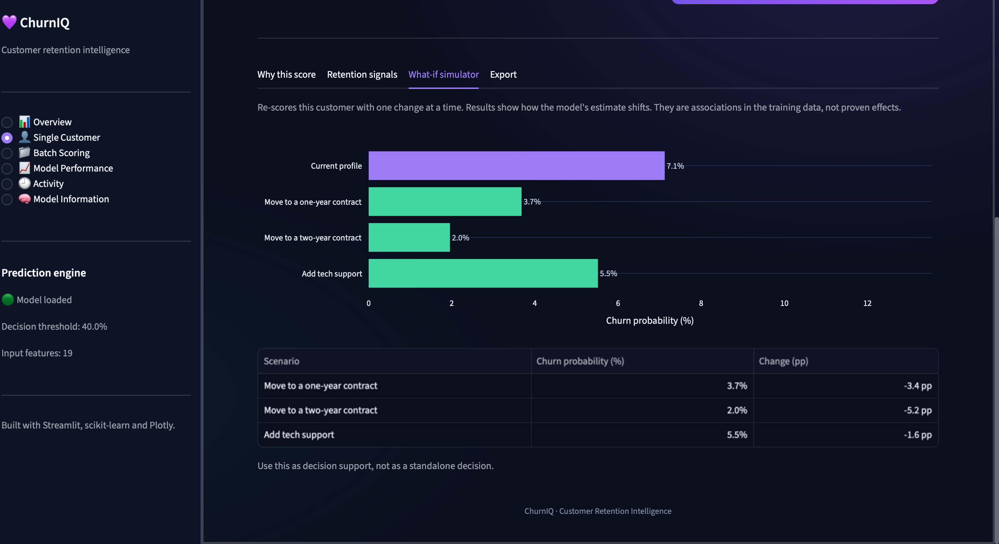
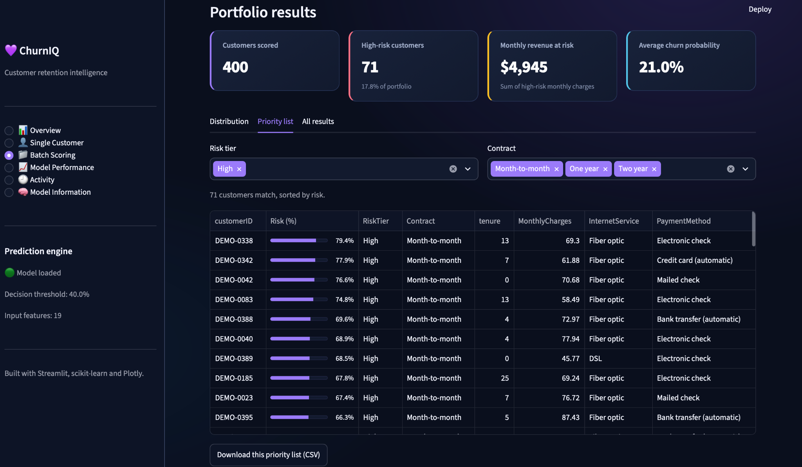

# 💜 ChurnIQ — Customer Churn Prediction

### AI-Powered Customer Retention Intelligence

ChurnIQ is an interactive machine learning application designed to predict customer churn in the telecommunications industry and support data-driven customer retention decisions.

Built with **Python, Scikit-learn, Streamlit, and Plotly**, the application transforms customer data into actionable risk insights through predictive analytics, interactive visualizations, and scenario simulations.

---

## ✨ Key Features

### 👤 Single Customer Prediction
- Predict individual customer churn probability.
- Visualize predictions using an interactive risk gauge.
- Classify customers into different risk levels.
- Explore customer attributes associated with predicted churn risk.

### 🧠 Explainable Predictions
- Understand which customer features contribute to model predictions.
- Identify factors associated with higher or lower churn risk.
- Explore retention-related signals.

### 🔄 What-if Simulator
- Compare churn predictions under hypothetical customer scenarios.
- Explore changes in contract duration and support services.
- Visualize differences in predicted churn probability.
- Support customer retention analysis through scenario comparisons.

### 📂 Batch Customer Scoring
- Upload customer datasets in CSV format.
- Generate churn predictions for multiple customers.
- Identify and prioritize high-risk customers.
- Analyze risk distributions and monthly revenue at risk.
- Filter customer segments and export prediction results.
- Explore a synthetic demo portfolio containing 400 customers.

### 📈 Model Performance Dashboard
- Evaluate the model using labeled test datasets.
- Visualize ROC curves and confusion matrices.
- Analyze Accuracy, Precision, Recall, F1 Score, and ROC-AUC.
- Explore the relationship between classification thresholds and model performance.

---

## 🛠️ Tech Stack

| Category | Technologies |
|----------|-------------|
| Programming Language | Python |
| Data Processing | Pandas, NumPy |
| Machine Learning | Scikit-learn |
| Web Application | Streamlit |
| Data Visualization | Plotly |
| Model Serialization | Joblib |
| Development Environment | VS Code, Jupyter / Google Colab |

---

## 🤖 Machine Learning Pipeline

The customer churn prediction pipeline consists of the following stages:

1. **Data Preparation**
   - Data cleaning and preprocessing
   - Missing-value handling
   - Exploratory data analysis

2. **Feature Engineering**
   - Categorical feature encoding
   - Numerical feature scaling
   - Preparation of model input features

3. **Model Development**
   - Logistic Regression classification
   - Scikit-learn preprocessing pipeline
   - Model training and evaluation

4. **Model Evaluation**
   - Evaluation on a held-out test dataset
   - ROC-AUC, Accuracy, Precision, Recall, and F1 Score
   - Confusion matrix analysis
   - Classification threshold analysis

5. **Application Development**
   - Model serialization using Joblib
   - Interactive Streamlit dashboard
   - Single-customer and batch predictions
   - Prediction explanations and scenario simulations

---

## 📊 Dataset

**IBM Telco Customer Churn Dataset**

The project uses the IBM Telco Customer Churn dataset, which contains customer demographic information, subscription details, service usage, and billing attributes.

| Dataset Property | Value |
|------------------|-------|
| Total Customers | 7,043 |
| Predictive Features | 19 |
| Target Variable | Churn |
| Classification Type | Binary Classification |
| Target Classes | Yes / No |
| Held-out Test Samples | 1,409 |

**Dataset Source:**

[IBM Telco Customer Churn — Kaggle](https://www.kaggle.com/datasets/blastchar/telco-customer-churn)

---

## 📈 Model Evaluation

The trained Logistic Regression model was evaluated on a held-out test set of **1,409 customers**.

A decision threshold of **0.40 (40%)** was applied to classify customers based on predicted churn probability.

### Model Performance Results

| Metric | Score |
|--------|-------|
| ROC-AUC | 0.8420 |
| Accuracy | 77.71% |
| Precision | 56.82% |
| Recall | 66.84% |
| F1 Score | 0.6143 |

### Key Insights

- **ROC-AUC of 0.8420:** Indicates good discrimination between customers who churn and those who remain.
- **Accuracy of 77.71%:** The model correctly classified approximately 78% of test customers.
- **Recall of 66.84%:** The model identified approximately 67% of actual churners.
- **Precision of 56.82%:** Approximately 57% of customers predicted to churn actually churned in the test set.
- **Decision Threshold of 40%:** Used to identify potentially at-risk customers.

All reported metrics were verified using the saved machine learning model and held-out test dataset.

---

## 📸 Application Screenshots

### 1. Overview Dashboard

An interactive overview of customer scoring activity and the prediction workflow.



### 2. Single Customer Prediction

Individual churn risk assessment with an interactive probability gauge and risk classification.



### 3. Batch Customer Scoring

Portfolio-level analysis showing customer risk distributions, high-risk segments, and monthly revenue at risk.



### 4. Model Performance Metrics

Evaluation dashboard displaying ROC-AUC, Accuracy, Precision, Recall, and F1 Score.



### 5. Model Evaluation Charts

ROC curve, confusion matrix, and classification threshold analysis.



### 6. What-if Simulator

Interactive scenario analysis comparing churn probabilities under hypothetical changes to customer attributes.



### 7. Customer Priority List

Risk-based customer prioritization with filtering and CSV export functionality.



---

## 🚀 Getting Started

### 1. Clone the Repository

```bash
git clone https://github.com/berivanilgenn/ChurnIQ-Customer-Churn-Prediction.git
cd ChurnIQ-Customer-Churn-Prediction
```

### 2. Create a Virtual Environment

```bash
python -m venv .venv
```

Activate the virtual environment.

**macOS / Linux:**

```bash
source .venv/bin/activate
```

**Windows:**

```bash
.venv\Scripts\activate
```

### 3. Install Dependencies

```bash
pip install -r requirements.txt
```

### 4. Run the Streamlit Application

```bash
python -m streamlit run app.py
```

The application will open in your browser, usually at:

http://localhost:8501

---

## 📁 Project Structure

```text
ChurnIQ-Customer-Churn-Prediction/
│
├── app.py
├── churn_model.pkl
├── churn_threshold.pkl
├── requirements.txt
├── README.md
├── test_data.csv
├── .gitignore
│
├── .streamlit/
│   └── config.toml
│
└── screenshots/
    ├── overview.png
    ├── single.png
    ├── batch.png
    ├── performance_metrics.png
    ├── performance_charts.png
    ├── what_if_simulator.png
    └── priority_list.png
```

---

## 💡 Business Applications

ChurnIQ demonstrates how predictive machine learning can support customer retention workflows.

Potential applications include:

- **Customer Risk Identification:** Identify customers with elevated predicted churn probabilities.
- **Retention Prioritization:** Organize customer outreach using risk-based segmentation.
- **Revenue Risk Analysis:** Estimate monthly charges associated with high-risk customers.
- **Scenario Exploration:** Compare model predictions under hypothetical customer profile changes.
- **Decision Support:** Provide interactive analytics for customer retention planning.

---

## ⚠️ Disclaimer

ChurnIQ is an educational and portfolio-oriented machine learning project.

Predictions represent statistical estimates rather than guaranteed customer outcomes.

What-if simulations illustrate hypothetical changes in model predictions and should not be interpreted as causal effects.

The application is intended for demonstration, learning, and analytical decision support.

---

## 👩‍💻 Project Focus

**Machine Learning | Data Science | Predictive Analytics | Customer Churn Prediction | Explainable AI | Customer Retention | Interactive Dashboards**

---

### 💜 ChurnIQ

*Turning customer data into actionable retention insights.*
